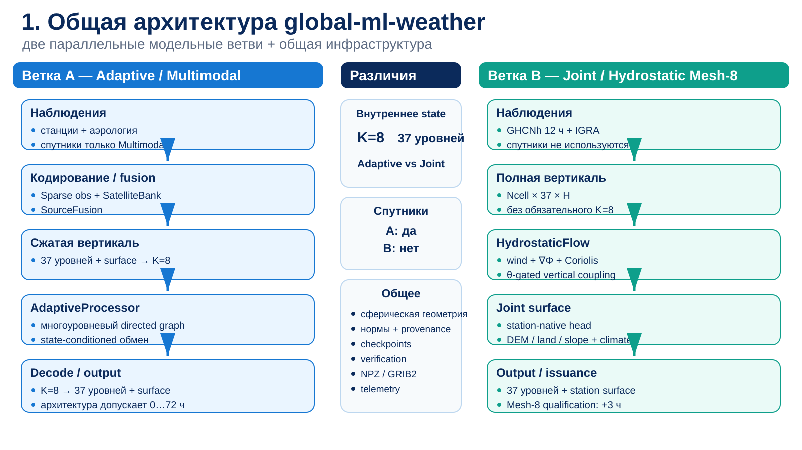
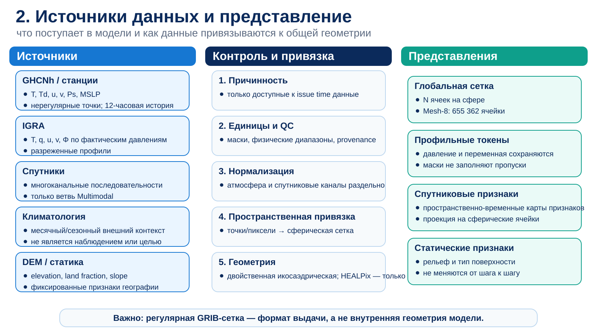
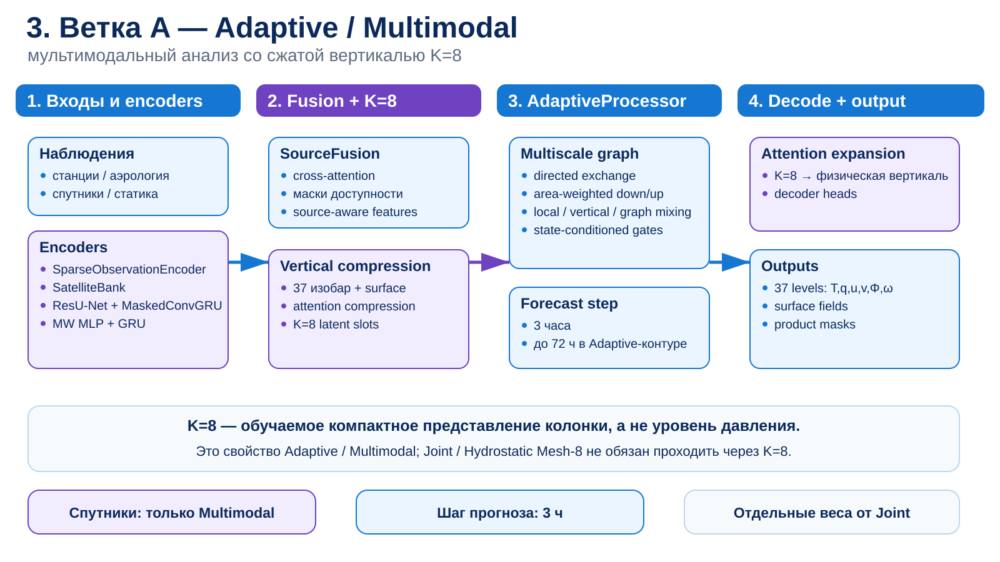
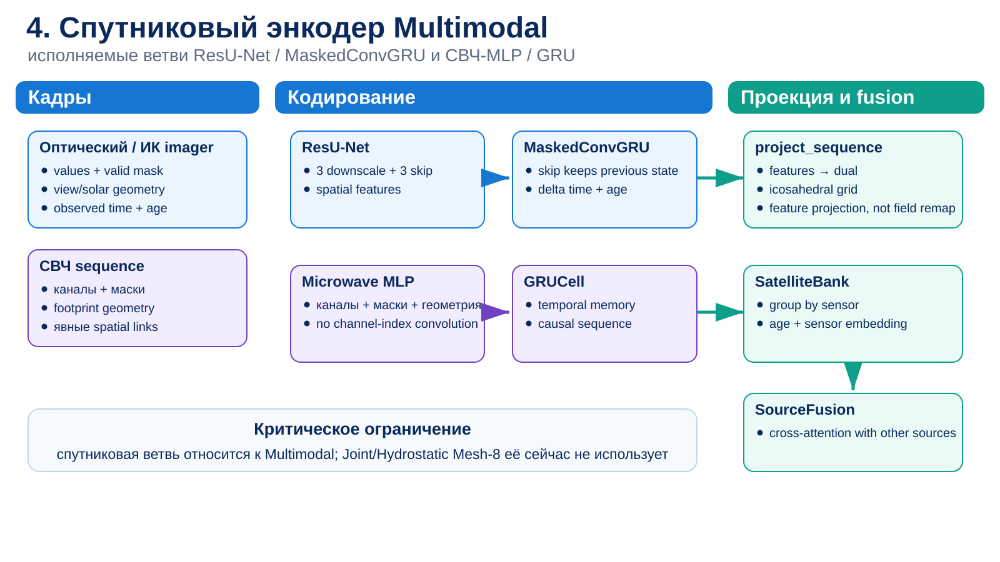
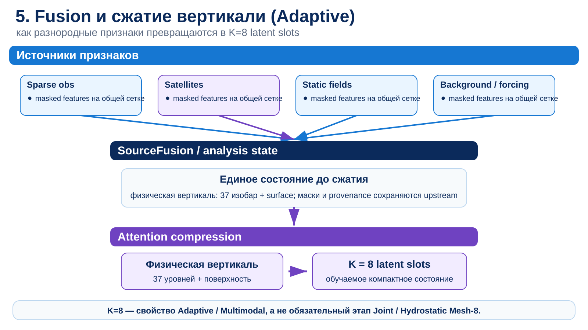
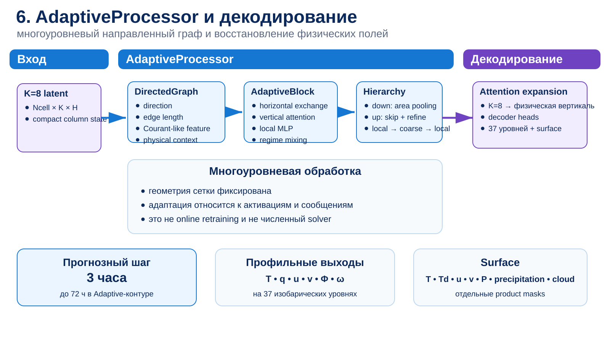
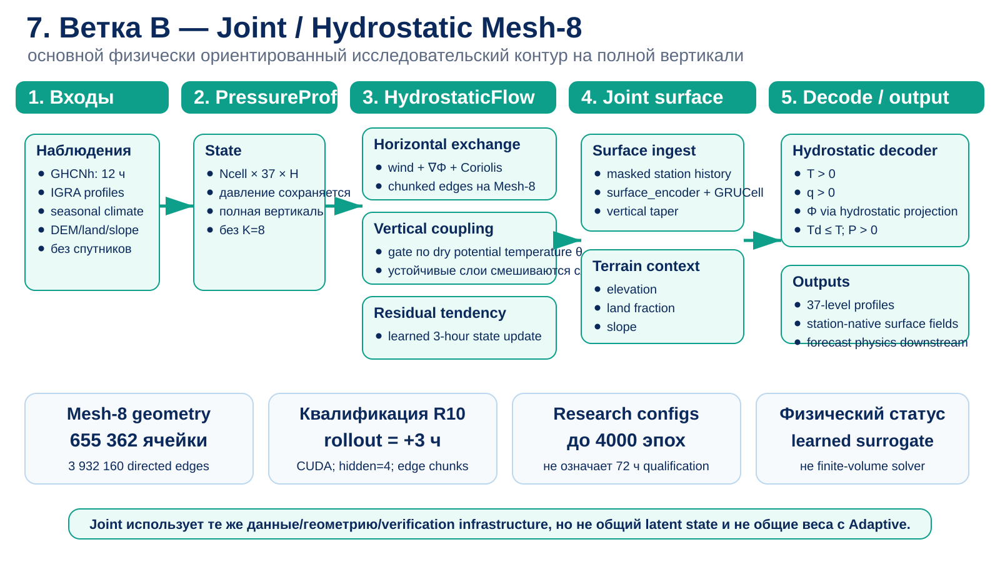
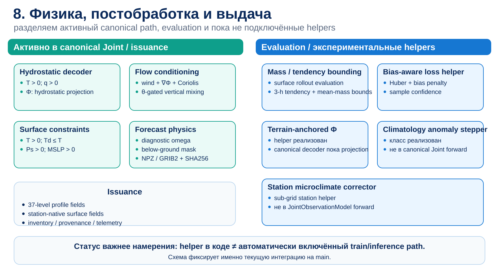

# Визуальная схема архитектуры global-ml-weather

Этот комплект схем отражает фактическое состояние `main` на 24 октября 2026 года и разделяет две модельные линии, которые раньше были показаны как один последовательный тракт.

Главное различие:

- `AdaptiveWeatherModel` / `MultimodalWeatherModel` используют обучаемое сжатие вертикали до `K=8` latent slots по умолчанию.
- `JointObservationModel` / `HydrostaticFlowProfileModel` работают непосредственно на 37 физических уровнях давления и не обязаны проходить через `K=8`.
- Спутниковые энкодеры относятся к Multimodal-ветви. Текущий Joint/Mesh-8 эксперимент спутниковые параметры не использует.
- Ветки используют общую инфраструктуру данных, сферической геометрии, нормировки, provenance, checkpoints, verification и выдачи, но не общий latent state и не общие веса.

> Изображения являются техническими схемами текущего кода. Для спорных деталей источником истины остаются код, конфигурации экспериментов и решения в `docs/decisions/`.

## 1. Общая архитектура



Система разделена на две параллельные ветви. Adaptive/Multimodal предназначена для мультимодального анализа и компактной вертикали. Joint/Hydrostatic Mesh-8 сохраняет полную 37-уровневую структуру и является текущим физически ориентированным контуром реальных GHCNh + IGRA опытов.

## 2. Источники данных и представление



Входы проходят причинный отбор, проверку единиц, масок, provenance и отдельную нормализацию. Внутренняя геометрия — двойственная икосаэдрическая сферическая сетка. HEALPix остаётся сравнительным направлением и не является текущей Mesh-8 геометрией.

## 3. Ветка Adaptive / Multimodal



`MultimodalWeatherModel` расширяет `AdaptiveWeatherModel` спутниковыми и разреженными источниками. После объединения признаков вертикальная колонка сжимается attention-механизмом до `K=8`, проходит через многоуровневый `AdaptiveProcessor` и затем разворачивается обратно в физические уровни и поверхность.

`K` — число скрытых позиций, а не число физических уровней давления. Код допускает `K=4/8/16/38`; стандартная конфигурация использует `K=8`.

## 4. Спутниковый энкодер Multimodal



Для imager-последовательностей реализованы `ResUNet` и `MaskedConvGRU`. Для микроволновой ветви используются спектральный MLP и GRUCell. Признаки переносятся на сферические ячейки функцией `project_sequence`; это перенос признаков, а не консервативная перепроекция физических полей.

Текущий `JointObservationModel` спутниковые параметры не использует.

## 5. Fusion и сжатие вертикали



`SourceFusion` объединяет доступные источники, после чего Adaptive-ветвь формирует компактное вертикальное состояние. Эта стадия не является обязательной для Joint/Hydrostatic Mesh-8.

## 6. AdaptiveProcessor и декодирование



`AdaptiveProcessor` использует направленные ребра, геометрические и state-conditioned признаки, локальный механизм, вертикальное внимание и многоуровневую down/up-иерархию. Геометрия сетки фиксирована; «адаптивность» не означает online retraining или автоматическое изменение сетки.

Adaptive-контур поддерживает трёхчасовой шаг и архитектурный горизонт до 72 часов.

## 7. Joint / Hydrostatic Mesh-8



Joint-контур строится как `PressureProfileModel → HydrostaticFlowProfileModel → JointObservationModel`.

Состояние имеет форму `Ncell × 37 × H`. Горизонтальный обмен обусловлен ветром, градиентом геопотенциала и ускорением Кориолиса. Вертикальная связь ослабляется при устойчивых скачках сухой потенциальной температуры. Декодер обеспечивает положительные `T` и `q` и гидростатически согласованный геопотенциал. Surface-ветвь выдаёт station-native `T`, `Td`, `u`, `v`, `Ps`, `MSLP` с базовыми физическими ограничениями.

Для Mesh-8: 655 362 ячейки и 3 932 160 направленных рёбер. Квалификационный R10 ограничен rollout `+3 ч`; наличие исследовательских конфигураций вплоть до 4000 эпох не означает квалификацию 72-часового Mesh-8 inference.

## 8. Физика, evaluation и выдача



Схема разделяет три статуса:

1. Физика, реально участвующая в canonical Joint path: гидростатический decoder, flow conditioning, vertical stability gating и hard-domain ограничения surface-head.
2. `forecast physics / issuance`: diagnostic omega, геометрическая below-ground mask, NPZ/GRIB2, inventory и SHA256.
3. Новые вспомогательные механизмы, которые нельзя автоматически считать частью canonical forward: terrain-anchored hydrostatic integration, `ClimatologyAnomalyStepper`, `StationMicroclimateCorrector`. Ограничение глобальной массы и 3-часовых тенденций уже подключено в `scripts/evaluate_mesh8_all_leads.py`, то есть в evaluation path, а не в основной frozen inference.

## Как связаны две ветви

Сейчас ветки параллельны:

```text
общие данные / геометрия / нормы / provenance
                    │
           ┌────────┴────────┐
           │                 │
 Adaptive / Multimodal   Joint / Hydrostatic
      K=8 latent          37 physical levels
           │                 │
           └────────┬────────┘
                    │
        verification / issuance infrastructure
```

Выход Adaptive не подаётся автоматически в Joint, и checkpoint одной ветви несовместим с другой. Возможное будущее объединение — использовать Multimodal как learned analysis/assimilation encoder и передавать физически декодированное 37-уровневое состояние в HydrostaticFlow processor. Это направление, а не текущий canonical graph.

## Связанные документы

- [Точная архитектура и ограничения](ARCHITECTURE.md)
- [Контракт данных](DATA_CONTRACT.md)
- [Многомодальная модель](MULTIMODAL.md)
- [Обучение](TRAINING.md)
- [Справочные данные и DEM](REFERENCE_DATA.md)
- [Mesh-8 qualification](decisions/0018-mesh8-end-to-end-qualification.md)
