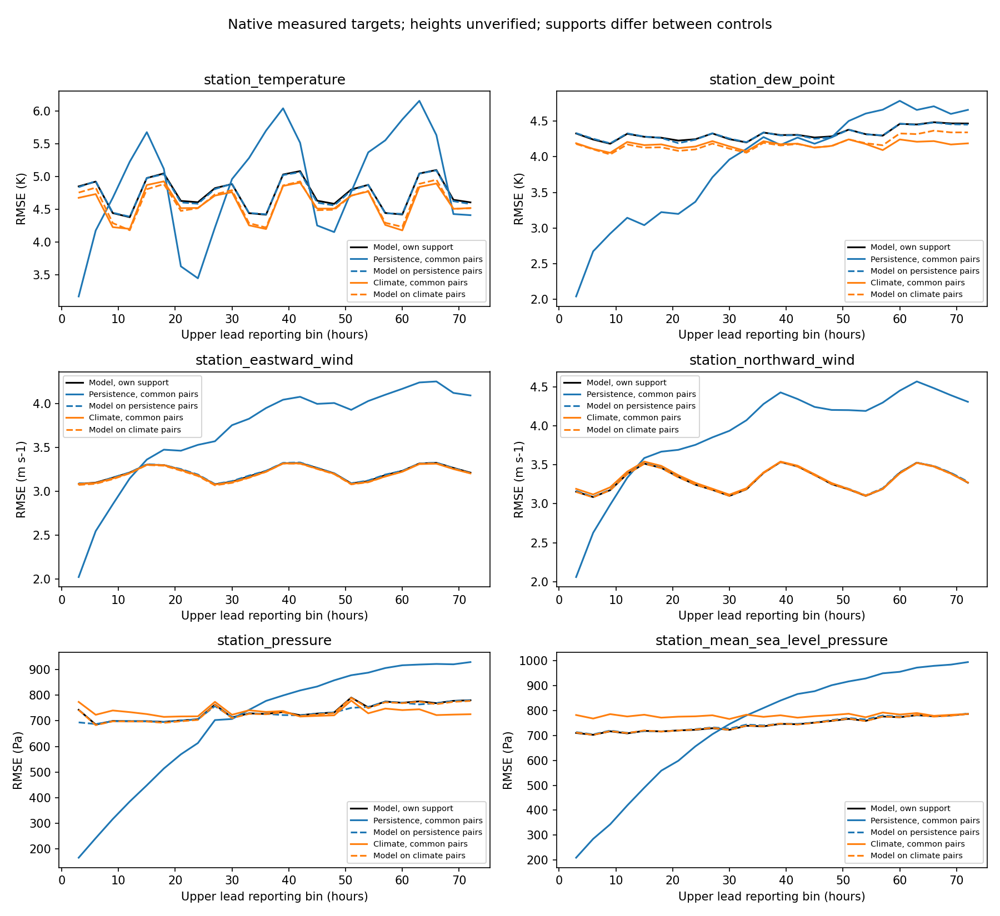
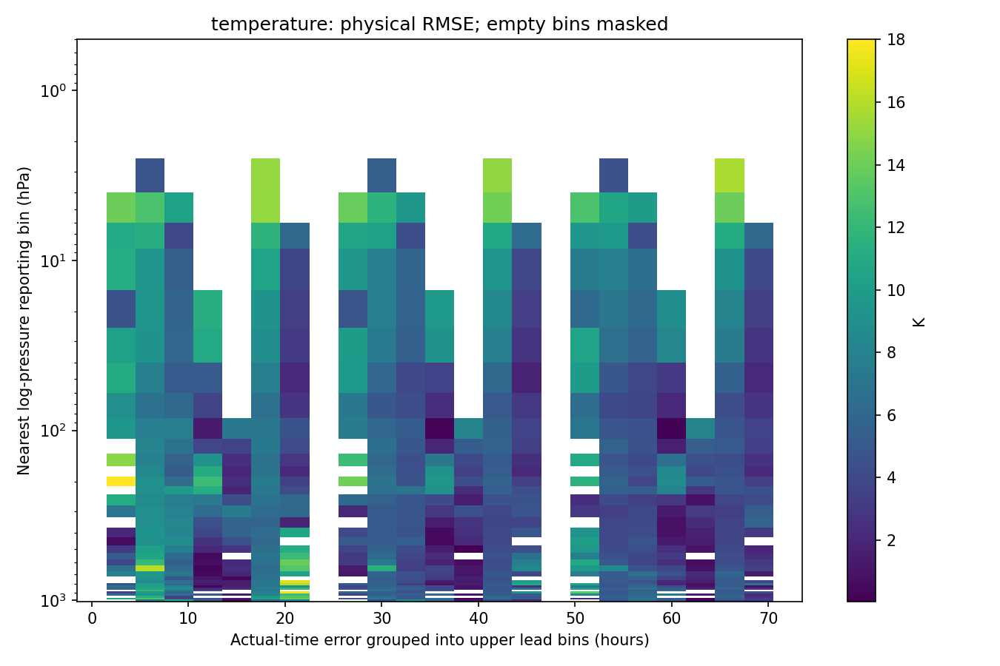

# Полная проверка сентября 2022 года

Отчёт: 13 октября 2026 года. Месячный расчёт выполнен 12 октября UTC.
Исходники оценки: `df9639cb1d0bb3a1607b9016a43860a20dfa4039`.
Исходники пересчёта и графиков: `a598e6e3d63f600cd26d1d6c5ce28c8dd74e102d`.
Это исторический пилот mesh2. При интеграции сохранены последующие изменения
`main` для квалификационного mesh8, базовый SHA
`b57d1419ed785b9109f0ef45861e93490401bdff`. Его результаты здесь не оценивались.
Для повторного расчёта пилота нужна указанная историческая ревизия;
новые исходники не должны обходить проверку идентичности старых весов C2.
Постановка: [решение 0018](../../decisions/0018-monthly-forecast-verification.md).

Проверены все 30 выпусков сентября, ежедневно 06 UTC, до +72 часов.
Цели последних выпусков продолжаются до 3 октября. Использована неизменная
эпоха 12, SHA256 весов
`5aedf87c304ead44b745f04c06b1e7c88d2f9924337d6a109b4eb28ce654d22f`.
Обучение заново не запускалось. ERA5 и синтетические цели не использовались.

Получены 728575 профильных и 6415447 станционных сравнений с реальными
наблюдениями IGRA и GHCNh. Пересчёт всех 7144022 сохранённых пар точно
воспроизвёл дневные таблицы, месячные суммы, метрики и skill.
Из 737173 профильных кандидатов 8598 не поддержаны оператором/нормами.
На этом архиве дополнительный влажностный QC не исключил записей.
Скалярные сравнения, повторяемые в разных выпусках, не являются независимыми
погодными случаями. Интервалы неопределённости не рассчитывались.

## Почему обучение остановилось на 12 эпохах

Это вручную заданный мной бюджет пилота, а не ранняя остановка и не
оптимальное число эпох. Выполнены только 576 обновлений на 48 train-выпусках
за эпоху; validation использовала 12 выпусков. Потеря улучшалась до
последней эпохи. [Машинный аудит](evidence/training-audit-after.json)
определяет `stop_reason=epoch_budget` и отсутствие доказанной сходимости.

Прежние настройки не были полностью перенесены в новую совместную сеть:
500 эпох, hidden=128, cosine scheduler и batch=4 в прежнем unified-конфиге
сменились 12 эпохами, hidden=32 и отдельными обновлениями выпусков.
Прежний unified-тренировщик также не обучал профильную ветвь непосредственно.
Перенос отдельных learning rate/weight decay/clip из R9 не доказывает
оптимальность новой архитектуры. Полное сравнение находится в
[руководстве](../../MONTHLY_FORECAST_VERIFICATION.md).

## Измеренное качество

Все строки таблицы используют одинаковые цели сети и соответствующего
контроля. Давление — метка ближайшего log(p)-интервала; оператор сравнивает
прогноз в фактическом давлении измерения.

| Величина и срок | RMSE сети | RMSE контроля | Общих целей | Контроль |
| --- | --- | --- | --- | --- |
| Температура, интервал 850 гПа, +66 ч | 5,631 K | 5,130 K | 789 | NOAA-климатология |
| Геопотенциал, интервал 500 гПа, +66 ч | 1131,667 м²/с² | 926,080 м²/с² | 591 | NOAA-климатология |
| Восточный ветер, интервал 500 гПа, +66 ч | 11,630 м/с | 9,995 м/с | 992 | NOAA-климатология |
| Северный ветер, интервал 500 гПа, +66 ч | 9,297 м/с | 9,136 м/с | 992 | NOAA-климатология |
| Станционная температура, +72 ч | 4,583 K | 4,412 K | 57156 | Последнее доступное измерение |
| Станционная температура, +72 ч | 4,518 K | 4,521 K | 57251 | Станционный train-климатический фон |

Профильная ошибка сети превосходит климатический контроль в этих строках.
По всему набору общих профильных целей RMSE хуже климатологии на 28,7%
для T, 29,1% для q, 37,9% для u, 2,5% для v и 53,2% для геопотенциала.
Это объединение скаляров различных давлений, а не площадная глобальная оценка.
Наземные T и Td почти воспроизводят климатический фон; MSLP показывает
улучшение RMSE относительно своего контроля примерно на 4,5%.
Без оценки неопределённости положительное различие не объявляется значимым.

Для выпусков в 06 UTC профильные наблюдения не попадают ровно в +72 часа;
последний заполненный стандартный срок — +66. На +72 профильные строки
содержат count=0/null, а не вымышленную проверку. Для отдельной проверки
синоптических +24/+48/+72 нужны заранее закреплённые выпуски в 00/12 UTC.
Omega не имеет реальных целей в этих архивах. q при фактическом p < 300 гПа
проверяется как экстраполяция вне прямого обучения; пограничный интервал
300 гПа смешивает фактические давления, поэтому точная отметка есть в парах.

## Таблицы, графики и воспроизводимость

[Все 5700 строк метрик](results/metrics.csv) содержат MAE/RMSE/bias/count,
профильные 37 интервалов, 25 сроков, шесть профильных и шесть родных
наземных величин, парные контроли и RMSE skill.
[Счётчики](results/counts.csv) показывают поддержку каждой строки.
[Сводка](results/summary.json) связывает таблицы и графики с хэшами проверки.

Дополнительные графики:
[q](results/specific_humidity-rmse.png), [u](results/u-rmse.png),
[v](results/v-rmse.png), [геопотенциал](results/geopotential-rmse.png).
Белые области обозначают отсутствие поддержанных измерений.

Сначала сохранены все причинные прогнозы, затем открыты будущие цели.
Оценка использует исходные поля до прогнозной маски рельефа: сеть не может
улучшить результат, скрыв ошибочные значения маской выдачи.
Климатические контроли и сохранение измерения имеют отдельные общие с сетью
маски. Запасные станционные нормы без поддержки нужного train-месяца
исключены только из контроля; ошибки сети остаются.

Полные GRIB2, исходные поля, пары и исключения находятся на узле:
`/home/user/global-ml-weather-monthly-20261012/outputs/september-2022`.
Объём — 2153801424 байта, меньше бюджета 3 ГБ.
Месячный процесс завершился с кодом 0 за 30 мин 24,18 с;
пиковый RSS — 2741788 КиБ. Пересчёт завершился с кодом 0 за 1 мин 27,42 с.
Стоимость и энергопотребление не измерялись.
В сохранённой телеметрии 30 выпусков модельный проход до 72 часов
занимал 0,160–0,346 с (медиана 0,165 с) на RTX 4090.
Это по одному проходу без прогрева; чтение архивов, проверка хэшей,
запись GRIB2 и оценка целей в этот таймер не входят.
Веса содержат 29547 параметров; быстрая малая сеть не доказывает
приемлемую точность или высокое пространственное разрешение.

Независимое декодирование на ревизии
`42f2e1b7bf7793dec69dd088c583909cf4873abf` проверило все 167250 сообщений
в 30 GRIB2 (5575 на выпуск). Проверены состав, коды WMO, единицы,
экспериментальный статус, 37 уровней, 25 сроков, геометрия сетки,
самостоятельные bitmap и конечность поддержанных значений.
Код возврата 0, длительность 2 мин 12,37 с, пиковый RSS 79356 КиБ.
[Паспорт декодирования](evidence/grib-check.json) и
[журнал](evidence/grib-check.log) фиксируют хэши всех продуктов.
Это проверка формата, а не научная приёмка прогнозов.

Матplotlib использован из установленных системных пакетов в отдельном
процессе отчёта: Python 3.11.2, NumPy 1.24.2, matplotlib 3.6.3.
Численная среда обучения и сами веса не изменялись. Новых загрузок не было.
Нормы GraphCast, NOAA-контекст, GHCNh/IGRA, DEM и независимая маска суши
связаны полным `identity` в [паспорте проверки](evidence/verification.json).
Ревизии поставщиков не обновлялись; действуют
[закреплённые источники](../../../configs/ecosystem_sources.json).

## Инженерная проверка интеграции

Исправленная ревизия `bb22ca764cbcc267a895dad95d3e577b1e49a478`
испытана на отдельной чистой копии узла. Полный pytest:
923 passed, 1 skipped (CUDA-проверка отдельно), 138,97 с.
Новые модули: 46 passed. Команды обязательных сценариев находятся в
[скрипте испытаний](evidence/remote-qa-command.sh), результаты — в
[журналах](evidence/full-pytest.log). Научная приёмка остаётся отрицательной.

## Следующие контролируемые опыты

1. Проверить недостаток числа обновлений отдельным опытом до 100 эпох,
   patience 12, при прежних seed/сети/48 train/12 validation и неизменных нормах.
   Оценка длительности по пилоту — около 12–14 часов, не измеренный результат.
2. Отдельно проверить использование всех допустимых train/validation-выпусков
   и распределение входных профильных скаляров по величине/давлению/региону.
3. Отдельно проверить начальное усвоение измерений: реконструкцию состояния
   на доступной истории и прогноз приращения наблюдаемой аномалии.
   График наземных величин показывает слабое отличие сети от климатического фона;
   это мотивирует гипотезу, но не доказывает единственную причину ошибки.
4. Сравнивать hidden=32/64, баланс ветвей и сетку при одинаковом бюджете,
   выбирая веса по validation. Новый независимый период использовать один раз.

Простая замена epochs в уже завершённом каталоге запрещена строгой проверкой
идентичности C2. Новый опыт требует нового каталога либо отдельно проверенной
процедуры передачи оптимизатора/RNG. Эта месячная диагностика не запускает
долгое обучение автоматически.

Сентябрь уже просматривался и не является новым независимым итоговым тестом.
Научная приёмка отсутствует. Инженерные тесты, совместимость GRIB2 и точность
погоды являются отдельными результатами; зелёный CI не устраняет выявленное
отставание от контролей.
